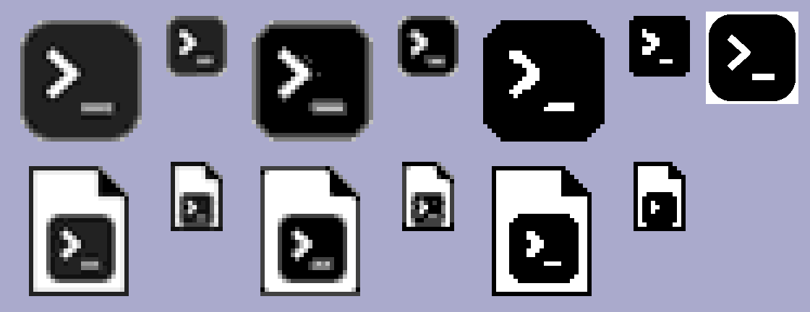

MacShell
========
An SSH client and Unix-style shell for classic Mac OS 7, 8 and 9 on 68k Macs.

MacShell is a fork of [SevenTTY](https://github.com/LXXero/SevenTTY) by LXXero, which is itself a
fork of [ssheven](https://github.com/cy384/ssheven) by cy384. It aims to be a clean, plain terminal
with current security libraries and the everyday command-line tools you know from Linux and macOS.



What's different from SevenTTY
------------------------------
* **Current security libraries**: libssh2 from upstream (November 2026, includes the
  Terrapin "strict key exchange" fix) and mbedTLS 3.6.7 LTS, built with unused features removed.
* **Real randomness for SSH and TLS**: classic Mac OS has no random number source, so MacShell
  gathers its own (see [Randomness](#randomness)) and refuses to make a secure connection until it
  has at least 256 bits.
* **A clean look**: white text on black by default, a plain prompt, plain `ls`. Colour text from
  programs (for example `ls --color` on a server) still works.
* **SSH keys made on the Mac** (`ssh-keygen`, kept in `~/.ssh`), used automatically by `ssh
  user@host` and `scp`.
* **An SSH server** (`sshd start`): log in to MacShell from another computer with a key, with a
  log in `~/.sshd/logs`.
* **Unix-style paths**: `/Macintosh HD/Documents`, `~`, `/` for the list of disks, `cd -`.
* **An interactive FTP client** with active and passive modes.
* **Mac files survive transfers**: files with a resource fork are sent as MacBinary, and MacBinary
  downloads are unpacked.
* **Real network tools**: ICMP `ping` and `traceroute`, `dig` and `nslookup` with their own DNS
  queries, and `curl` alongside `wget`.
* **Manual pages** for every command, and a test suite that runs every command on a Mac.
* **A new icon**, an original design.

Features
--------
* **SSH client**: key login (ECDSA P-256 or RSA) or password, known hosts checking. `ssh
  user@host` connects straight away with your key; `ssh` alone or Cmd+K opens the Connect dialog.
* **Local shell** with 95 commands, tab completion and history (up/down arrows):
  * Files: `ls`, `cd`, `pwd`, `cat`, `less`, `cp`, `mv`, `rm`, `mkdir`, `rmdir`, `touch`, `ln`,
    `readlink`, `realpath`, `basename`, `dirname`, `which`, `head`, `tail` (including `-f`), `file`
  * Text: `grep`, `wc`, `cut`, `nl`, `fold`, `rev`, `rot13`, `strings`, `echo`, `seq`, `dos2unix`,
    `unix2dos`, `mac2unix`, `unix2mac`
  * Bytes and checksums: `hexdump`, `xxd`, `cmp`, `md5sum`, `sha1sum`, `sha256sum`, `sha512sum`, `crc32`
  * System: `ps`, `free`, `df`, `uname`, `uptime`, `date`, `cal`, `hostname`, `history`, `sleep`,
    `clear`, `colors`, `entropy`
  * Mac-specific: `getinfo`, `settype`, `setcreator`, `fixtype`, `chattr`, `chmod`, `chown`, `label`, `open`
  * Network: `ssh`, `ssh-keygen`, `sshd`, `scp`, `ftp`, `wget`, `curl`, `telnet`, `nc`, `ping`,
    `traceroute`, `host`, `dig`, `nslookup`, `ifconfig`
* **Help**: `help` lists the commands; `man <command>` (or `<command> --help`) shows a manual
  page for each, `man macshell` explains paths and keys, and `man -k <word>` searches. The pages
  are plain text in `man/`, built into the application.
* **Command lines**: `;` and `&&` to run several commands, `>` and `>>` to save output, and an
  exit status for each command (used by `&&` and returned over SSH).
* **Windows and tabs**: Cmd+N opens a window; Cmd+T opens a shell tab, Cmd+S an SSH tab.
* **Terminal**: xterm-256color with 256 colours and true colour, bold, italic, underline, reverse
  video, a symbol font for box drawing, 100 lines of scrollback per tab, copy and paste.

Requirements
------------
* **CPU**: 68020 or later (a 68030 or faster is recommended for SSH)
* **RAM**: 3 MB for MacShell
* **System**: 7.1 or later (before 7.5, the Thread Manager extension is needed)
* **Network**: Open Transport for SSH, FTP, wget and curl. The local shell works without it.

MacShell is developed and tested in emulated Mac OS 9 (QEMU), where the test suite passes. It is
meant for a Macintosh LC with a 68030 accelerator running System 7.5.3, but hasn't been tested on
that hardware yet. The source still has SevenTTY's PowerPC build, but it hasn't been built or
tested since the changes above.

Randomness
----------
SSH and HTTPS keys are only as strong as the random numbers behind them, and classic Mac OS has
no random number source. MacShell gathers randomness from:

1. **Sound input noise**: the lowest bits of the microphone or line input, which carry analogue
   noise even with nothing plugged in.
2. **Clock jitter**: tiny timing variations between the processor and the Mac's VIA timer.

Each source must pass health tests based on NIST SP 800-90B (repetition, proportion and prediction
tests) and is credited conservatively; silence, hum and repeating patterns count for nothing. The
results are mixed with SHA-256 and saved to a seed file ("MacShell Random Seed" in the Preferences
folder), which is renewed on each launch.

If the sources and seed together give less than 256 bits, MacShell asks you to move the mouse and
type a few keys. Type `entropy` to see where the randomness came from.

Paths
-----
MacShell uses Unix-style paths:

* `/` lists the mounted disks; `/Macintosh HD/Documents` is a folder on the disk "Macintosh HD".
* `~` is the Documents folder on the startup disk (the disk with the active System Folder),
  created if missing. MacShell starts there, and `cd` on its own returns there.
* `cd -` goes back to the previous folder (and again to return).
* `.` and `..` work as usual, including `..` from a disk's top level back to `/`.
* Names with spaces need quotes or a backslash: `cd "/Macintosh HD/System Folder"`.
* A `/` inside a Mac file name is shown and typed as `:` (as macOS does).
* An old-style Mac path such as `Macintosh HD:Documents:notes` still works.

Interactive FTP
---------------
```
$ ftp 192.168.0.10
Username: (enter for anonymous)
ftp> ls
ftp> cd "To Mac"
ftp> get file.sit
ftp> put notes.txt
ftp> bye
```
* Press Return at the Username prompt to log in anonymously; you won't be asked for a password.
  Passwords for other accounts aren't shown as you type.
* Remote commands: `ls`/`dir`, `cd`, `cdup`, `pwd`, `get`, `put`, `mkdir`, `rmdir`, `delete`,
  `rename`, `size`. Local: `lcd`, `lpwd`, `lls`. Session: `passive`, `active`, `status`, `help`, `bye`.
* Passive mode is the default. `ftp -A host` (or `active` in a session) uses active mode, where the
  server connects back to the Mac; this needs the Mac to be reachable from the server.
* One-shot transfers also work: `ftp get user@host:/path/file`, `ftp put file user@host:/dir/`,
  `ftp ls user@host:/dir/`.
* Transfers are binary. A Mac file with a resource fork (an application, for example) is uploaded
  as MacBinary with `.bin` added to its name, so nothing is lost on a non-Mac server; a MacBinary
  download is unpacked into a working Mac file, and the `.bin` is kept.

wget and curl
-------------
* `wget <url>` saves to a file named from the URL (`index.html` for a site address) and never
  overwrites a file: it saves as `name.1`, `name.2` and so on instead. `-O file` chooses the name;
  `-O -` shows the download on screen. wget follows redirects.
* `curl <url>` shows the page on screen. `-o file` saves to a file, `-O` saves with the name from
  the URL, `-I` shows only the headers and `-L` follows redirects. curl stops if the data is binary
  and suggests `-o` instead.
* MacBinary downloads are unpacked (the `.bin` is kept); other files get a Mac type and creator
  from their extension.

SSH keys and the SSH server
---------------------------
* `ssh-keygen` makes an ECDSA P-256 key pair on the Mac, in `~/.ssh` (`id_ecdsa` and
  `id_ecdsa.pub`), optionally protected by a passphrase. Put the public key in
  `~/.ssh/authorized_keys` on the servers you use; `ssh user@host` and `scp` then use it without
  asking for anything.
* `sshd start` runs MacShell's own SSH server in its own tab, so another computer can log in with
  `ssh user@mac` (an interactive shell in a new tab) or run one command with `ssh user@mac
  'command'`, which returns the command's exit status. It accepts keys only, from
  `~/.ssh/authorized_keys` on the Mac (ECDSA P-256, or RSA of 2048 bits or more), uses ECDH
  P-256, AES-128-CTR with HMAC-SHA-256 and strict key exchange, and logs every connection and
  rejected key in `~/.sshd/logs/sshd.log` (never more than 512 KB). See `man sshd`.

DNS and network tools
---------------------
* `ping` sends real ICMP echo requests (until Ctrl+C, or `-c N`); `ping host port` tests a TCP
  port instead. `traceroute` shows the routers on the way to a host.
* `dig` and `nslookup` send their own DNS queries over UDP (A, AAAA, MX, NS, TXT, CNAME, SOA,
  PTR) and show the answers in their usual formats. `host` does simple lookups.
* `ifconfig` shows the address, netmask, gateway, DNS server, hardware address and MTU.

Security notes
--------------
* **HTTPS certificates are not checked.** Classic Mac OS has no certificate store, so `wget` and
  `curl` encrypt the connection but can't confirm who is on the other end. They print a warning
  each time. Don't rely on them for anything sensitive.
* **FTP and Telnet are not encrypted.** Passwords and files cross the network as plain text. Use
  them only on a network you trust; use SSH or `scp` otherwise.
* SSH checks the server's host key against MacShell's known hosts file.
* The SSH server is off until you start it, and accepts keys only, never passwords.

Colour schemes
--------------
**File → Preferences** has a **Color scheme** menu: White on Black (the default), Black on White,
Green on Black, Amber on Black, Solarized Dark and Solarized Light. **Theme File...** loads a
`.sttheme` file, and the Background and Text colour menus override a scheme's colours.

To convert an iTerm2 colour scheme to a `.sttheme` file:

```bash
python3 tools/itermcolors2sttheme.py MyTheme.itermcolors > MyTheme.sttheme
```

Keyboard shortcuts
------------------
| Shortcut | Action |
|----------|--------|
| Cmd+N | New window |
| Cmd+T | New shell tab |
| Cmd+S | New SSH tab |
| Cmd+W | Close tab or window |
| Cmd+D | Disconnect SSH, close tab or quit |
| Cmd+Q | Quit |
| Cmd+K | Connect (SSH) |
| Cmd+1 to Cmd+8 | Switch tabs |
| Cmd+C, Cmd+V | Copy, paste |
| Shift+Page Up/Down | Scroll back |
| Ctrl+C | Cancel the current command or transfer |

Tests
-----
`tests/remote/run_tests.py` runs every MacShell command on a Mac (real or emulated) over SSH and
checks its output and exit status, mostly against what Linux's own tools give for the same files:
over 100 tests, from checksums and text tools to FTP, `dig` and `traceroute`.
`tests/host/test_dnsmsg.py` tests the DNS code on the build computer against real DNS replies.
See `tests/README.md`.

Building
--------
Requires [Retro68](https://github.com/autc04/Retro68/) and cmake. MacShell's patched libssh2,
mbedTLS and libvterm are git submodules and are built automatically.

```bash
mkdir build-m68k && cd build-m68k
cmake .. -DCMAKE_TOOLCHAIN_FILE=/path/to/Retro68-build/toolchain/m68k-apple-macos/cmake/retro68.toolchain.cmake
cmake --build . --parallel $(nproc)
```

The result is `MacShell.bin` (MacBinary). The build sets the Finder's "has bundle" flag so the
icon appears. The 68k code uses no floating-point instructions, so MacShell runs on Macs without
an FPU.

To change the icon, edit and run `tools/make_icons.py icons.r docs/icon-preview.png`.

License
-------
BSD 2-Clause; see `LICENSE`.

Based on [SevenTTY](https://github.com/LXXero/SevenTTY) by LXXero and
[ssheven](https://github.com/cy384/ssheven) by cy384.
